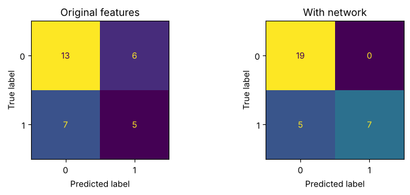
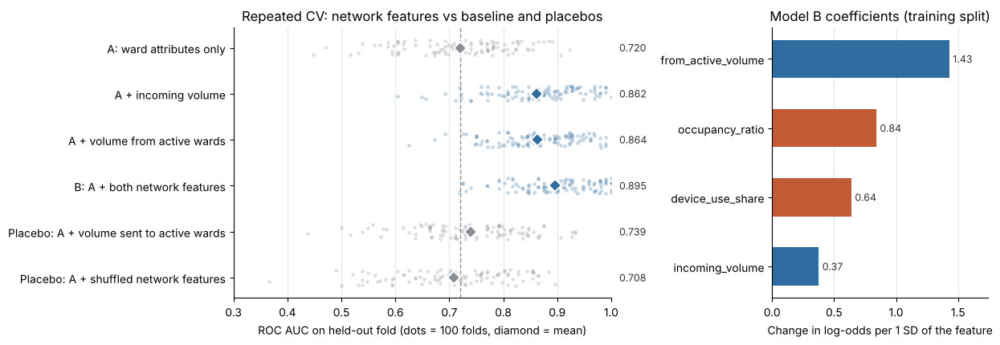
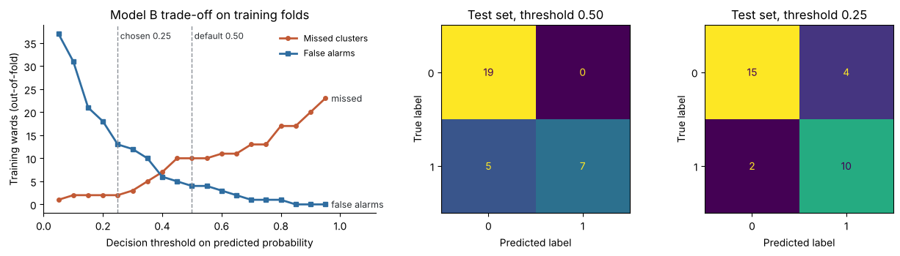

# Can earlier patient transfers help predict new infection clusters?

**Complex Systems and Applications, final project (Option 1: Hospital infection control)**. Author: marielandreou

**Start here:** [completed notebook](Hospital_Infection_Control_Completed.ipynb) · [PDF report](Hospital_Infection_Control_Report.pdf) · [figures](figures/)

This project models a regional hospital group as a **directed, weighted network** of wards linked by patient transfers. It tests whether that network adds predictive information about new infection clusters beyond two ward attributes. On the held-out test set the answer is clearly yes. Four further checks show that the gain is stable, that it depends on the **direction** of transfers, and where the model still fails.

> The data are synthetic teaching data. Nothing here is evidence about real hospitals or a basis for clinical decisions.

## 1. Problem

At the observation point, 18 of the 120 wards already have an active cluster. For the **102 wards without one**, the question is whether transfers recorded in the **preceding 14 days** help predict a **new** simulated cluster in the **following 14 days**, compared with occupancy and device use alone.

## 2. Data

| File | Contents |
|---|---|
| `hospital_wards.csv` (120 rows) | `occupancy_ratio`, `device_use_share`, `active_cluster_at_start` (known at the observation point), `new_cluster_later` (target, blank for the 18 wards already affected) |
| `hospital_transfers.csv` (420 rows) | `source_ward_id` → `destination_ward_id`, `transfer_count` (1–9) before the observation point |

The data come from the course URL `https://raw.githubusercontent.com/mikeauth/leap/main/hospital`. Copies are included here for offline runs. Of the 102 eligible wards, **39 (38%) later had a new cluster**. Every predictor uses only information available at the observation point, and `new_cluster_later` is used only as the target.

## 3. Method

1. **Exploration.** Compare occupancy and device use by later outcome among eligible wards. Both are higher on average in wards that later had a cluster, but the two groups overlap heavily.
2. **Network.** Build a `networkx.DiGraph` of all 120 wards, using `transfer_count` as the edge weight, and compute two features for each ward:
   - `incoming_volume`: all transfers the ward received.
   - `from_active_volume`: transfers received from wards that had an active cluster at the start.
3. **Fair comparison.** Make one stratified 70/30 split (`random_state=123`): 71 training wards and 31 test wards. Fit `StandardScaler` + `LogisticRegression` in a pipeline, so scaling is learned from training rows only.
   - **Model A:** occupancy + device use.
   - **Model B:** Model A + both network features.
4. **Evaluation.** Accuracy, F1 for the later-cluster class, ROC AUC from predicted probabilities, and a confusion matrix for each model.
5. **Extension.** 100 repeated cross-validation folds, an ablation of each feature, two placebo controls, an analysis of the missed clusters, and a decision threshold chosen on training data only.

## 4. Results

**Required comparison (the same 31 test wards for both models)**

| Model | Accuracy | F1 | ROC AUC | False alarms | Missed clusters |
|---|---|---|---|---|---|
| A: ward attributes | 0.581 | 0.435 | 0.693 | 6 of 19 | 7 of 12 |
| B: + network features | **0.839** | **0.737** | **0.904** | **0 of 19** | **5 of 12** |

All three metrics improve, so the result is clear rather than mixed.

**Robustness checks (100 repeated cross-validation folds)**

| Feature set | Mean ROC AUC | Gain vs A | Folds beating A |
|---|---|---|---|
| A: ward attributes only | 0.720 | – | – |
| A + incoming volume | 0.862 | +0.142 | 96% |
| A + volume from active wards | 0.864 | +0.144 | 100% |
| **B: A + both network features** | **0.895** | **+0.175** | **98%** |
| Placebo: A + volume *sent to* active wards | 0.739 | +0.019 | 59% |
| Placebo: A + network features shuffled across wards | 0.708 | −0.013 | 34% |

- **The gain is stable.** Model B beats A in 98 of 100 folds. The folds reuse the same wards, so this is a stability check rather than a significance test.
- **Direction matters.** Reversing the transfers adds almost nothing, and shuffled features add nothing, so the gain is not just an effect of adding columns.
- **The model recovers the published construction rule.** Exposure to active wards has the largest coefficient (1.43), and the four features rank in the same order as in the rule.

**Where the model fails.** All five clusters Model B missed were in wards with little or no recorded exposure. A threshold chosen on training data only (0.25) would cut misses on the test set from 5 to 2, at the cost of 4 false alarms.

## 5. Interpretation and limitations

Adding earlier directed transfers clearly improved prediction on this test set, and the gain is stable across repeated splits. Total incoming volume measures how busy a ward's intake is. Volume from initially affected wards measures exposure to existing clusters, and it carries most of the signal.

**Limitations**
- The data are synthetic and small, and the outcome was generated from these features.
- A transfer link is not an infection route, and a better score shows neither causation nor clinical usefulness.
- Validation used random splits, not time-ordered ones.

**Ethics.** If flags like these guided infection control, the two kinds of error would harm people in different ways:
- A **false alarm** diverts screening, isolation beds and staff time.
- A **missed cluster** leaves patients and staff unprotected. Because misses concentrate in wards outside the main transfer routes, those wards would be systematically under-protected.

The infection-prevention team and ward clinicians should therefore review flags, set the miss/false-alarm balance as an explicit policy, and audit errors across ward types.

## 6. Reflection

- **What worked well:** Building the comparison as a pipeline made it fair by construction, and the placebo controls showed that the gain depends on *who sent* the patients.
- **What was difficult:** With 31 test wards, one ward changes F1 by about 0.06, so judging the size of the gain needed repeated cross-validation. Every feature also had to use only the initial status.
- **What I would improve:** Validate on a later time period, try multi-step exposure measures such as PageRank, calibrate the probabilities, and test on independent data with clinicians before any real use.

## 7. Files and how to run

| File | Purpose |
|---|---|
| `Hospital_Infection_Control_Completed.ipynb` | Completed notebook, all cells run, outputs visible |
| `Hospital_Infection_Control_Report.pdf` / `.html` | Exports of the notebook |
| `figures/` | Key plots from the notebook |
| `hospital_wards.csv`, `hospital_transfers.csv` | Course data (offline fallback) |
| `requirements.txt` | Python packages |

To run: `pip install -r requirements.txt`, then open the notebook and choose **Kernel → Restart & Run All**. A full run takes under 30 seconds. Tested with Python 3, numpy 2.5, pandas 3.0, matplotlib 3.11, networkx 3.6 and scikit-learn 1.9.
